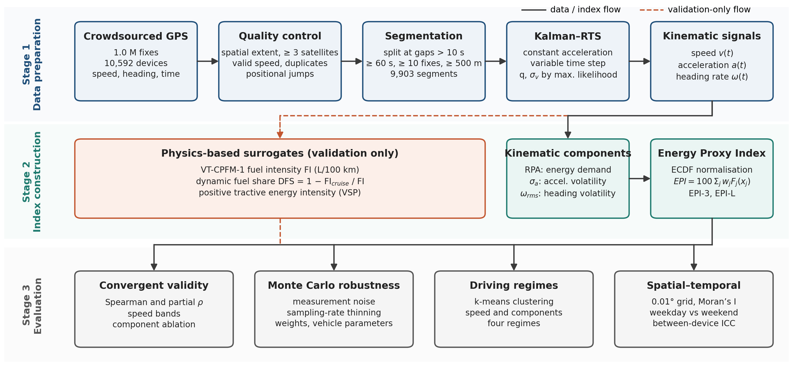

# GPS-Driven Energy Proxy Index (EPI)

A vehicle-agnostic index of driving-related energy demand computed from **smartphone GPS speed, heading and time only**, benchmarked against microscopic fuel models (VT-CPFM-1, vehicle-specific power) on one million crowdsourced fixes from Kuwait.

This repository contains the analysis code and figures for the manuscript:

> *A vehicle-agnostic energy proxy index from crowdsourced smartphone GPS: kinematic volatility benchmarked against microscopic fuel models in Kuwait* (under review).



## Key results

| Index | ρ with dynamic fuel share | Partial ρ (speed-controlled) |
|---|---|---|
| EPI-L (RPA + σ<sub>a</sub>), recommended | 0.76 | 0.88 |
| EPI-3 (RPA + σ<sub>a</sub> + ω<sub>rms</sub>) | 0.66 | 0.83 |
| Heading volatility (ω<sub>rms</sub>) alone | 0.32 | 0.37 |

- 9,903 driving segments from 2,589 devices after quality control.
- Rankings are stable under 0.5 m/s added speed noise (ρ ≥ 0.98), random weights (median ρ = 0.97) and a wide range of vehicle parameters; they degrade when sampling drops to one fix every ~6 s.
- Directional (heading) volatility does not track longitudinal energy physics and is best reported as a separate manoeuvring indicator.

## Method in brief

1. **Quality control and segmentation**: Kuwait extent, ≥ 3 satellites, valid speed, duplicate and positional-jump removal; segments split at gaps > 10 s and kept if ≥ 60 s, ≥ 10 fixes and ≥ 500 m.
2. **Kinematic reconstruction**: constant-acceleration Kalman filter with Rauch–Tung–Striebel smoothing for irregular time steps; noise parameters (q, σ<sub>v</sub>) estimated by maximum likelihood with a hold-out check.
3. **Components**: relative positive acceleration (RPA), acceleration volatility (σ<sub>a</sub>), RMS heading rate (ω<sub>rms</sub>).
4. **Index**: `EPI = 100 · Σ w_j F_j(x_j)`, with F<sub>j</sub> the empirical CDF of component j.
5. **Validation (surrogates only)**: VT-CPFM-1 fuel intensity and dynamic fuel share `DFS = 1 − FI_cruise / FI` (2014 Cadillac SRX parameters), and positive VSP energy intensity.
6. **Evaluation**: Spearman and partial correlations, component ablation, Monte Carlo robustness (noise, thinning, weights, vehicle parameters), k-means regimes, Moran's I, between-device ICC.

## Repository structure

```
src/epi/core.py                     cleaning, segmentation, Kalman–RTS, VT-CPFM, VSP, features, EPI
scripts/01_prepare_segments.py      quality control and segmentation
scripts/02_tune_kalman.py           maximum-likelihood estimation of q and sigma_v
scripts/03_smooth_and_features.py   smoothing and segment-level indicators
scripts/04_validation.py            correlations, speed bands, ablation, weighting
scripts/05_montecarlo.py            noise and sampling-rate Monte Carlo
scripts/06_regimes_spatial_vehicle.py  weight and vehicle Monte Carlo, ICC, clustering, spatial and temporal analysis
scripts/07_figures.py               all figures
figures/                            figures as used in the manuscript
data/raw/                           place input CSV files here (not distributed)
outputs/                            intermediate files and results (created at run time)
```

## Data

The raw data are **not included**. They contain device identifiers and precise coordinates and were provided by a third party under terms that do not permit redistribution. The code expects CSV files named `GPS*_0.csv` in `data/raw/` (or in the folder given by the environment variable `EPI_DATA_DIR`) with the columns:

| Column | Description |
|---|---|
| `GPSTime` | fix timestamp (`YYYY-MM-DD HH:MM:SS`) |
| `loc` | `"latitude,longitude"` |
| `CallerID` | anonymised device identifier |
| `CallerType`, `CallerOS`, `CallerVersion` | device and application metadata |
| `NumOfSatellite` | satellites used in the fix |
| `LoggedTime` | server log time |
| `Speed` | Doppler speed (km/h; negative = unavailable) |
| `Heading` | heading in degrees (−1 = unavailable) |

The pipeline can be applied to any GPS dataset with timestamp, position, speed and heading by adapting `load_raw()` in `src/epi/core.py`. The spatial extent is set by `KUWAIT_BBOX`.

## Installation and usage

```bash
git clone https://github.com/<your-account>/gps-energy-proxy-index.git
cd gps-energy-proxy-index
python -m venv .venv && source .venv/bin/activate
pip install -r requirements.txt

# put GPS*_0.csv into data/raw/, then:
python scripts/01_prepare_segments.py
python scripts/02_tune_kalman.py
python scripts/03_smooth_and_features.py
python scripts/04_validation.py
python scripts/05_montecarlo.py all      # about 10 to 15 minutes on one core
python scripts/06_regimes_spatial_vehicle.py
python scripts/07_figures.py
```

Or run everything with `bash run_all.sh`.

`02_tune_kalman.py` reports the estimation and hold-out fits and, by default, applies the values used in the paper (q = 0.145 m²/s⁵, σ<sub>v</sub> = 0.335 m/s). Set `USE_PAPER_VALUES = False` to use the average of the two fits instead.

## Using the index on your own data

```python
import sys; sys.path.insert(0, "src")
from epi.core import load_raw, clean, segment, smooth_all, seg_features, epi

d = load_raw()
d, log = clean(d)
d, log = segment(d, log)
d["vs"], d["acc"] = smooth_all(d, q=0.145, r=0.335**2)
agg = seg_features(d)                                   # one row per segment
agg["EPI_L"] = epi(agg, (0.5, 0.5), comps=["RPA", "sigma_a"])
agg["EPI_3"] = epi(agg)                                 # RPA, sigma_a, omega_rms
```

EPI values are relative to the reference population used for the ECDF (argument `ref` of `epi()`). For longitudinal monitoring, fix a reference distribution.

## Limitations

The fuel models are used as surrogates for validation only; no measured fuel data were available. Grade is ignored; the baseline vehicle is a single mid-size SUV (a vehicle Monte Carlo is provided). See the manuscript for full discussion.

## Citation

If you use this code, please cite the manuscript (full reference to be added on publication).

## License

MIT License. See `LICENSE`.
